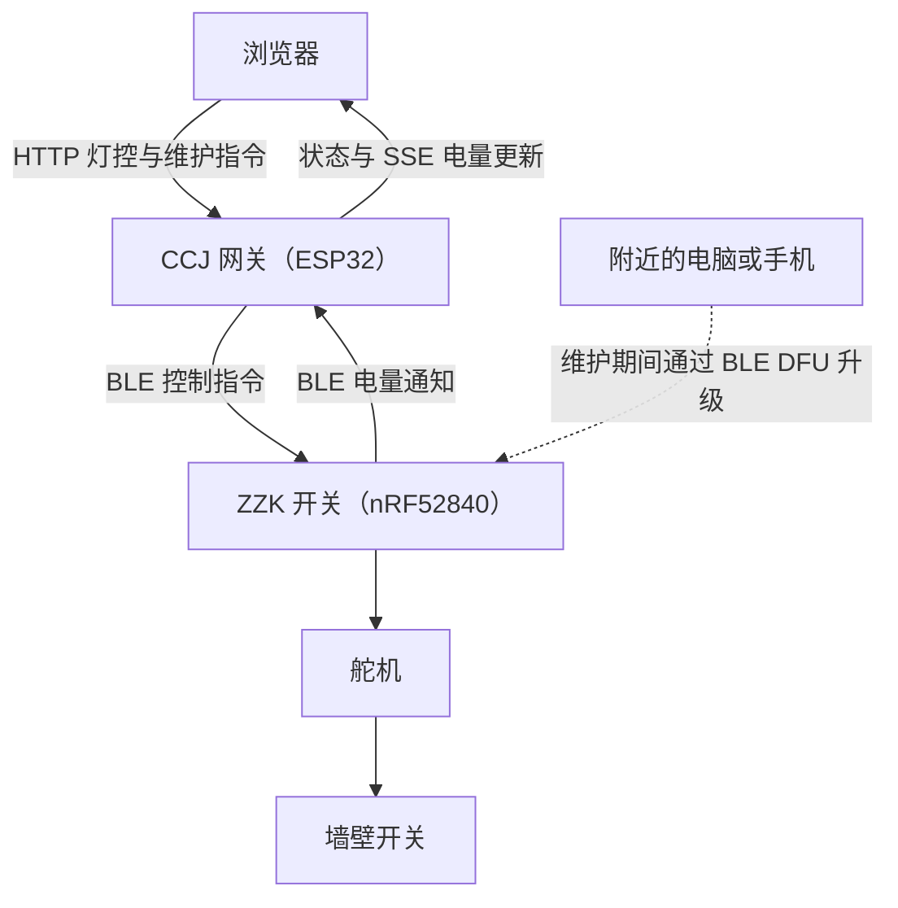

# CCJ Gateway

[English](readme.md) | **中文**

[快速开始](#快速开始) · [硬件](#硬件与软件) · [BLE 协议](#ble-协议) · [OTA 维护](#ota-维护模式) · [HTTP 接口](#http-接口) · [已知限制](#已知限制)

CCJ Gateway 是为 [ZZK Switch Assistant 2（ZZK-SA2）](https://github.com/coauther/ZZK-BLE-Switch-Assistant/blob/main/README.zh-CN.md) 配套开发的 ESP32 Wi-Fi 转 BLE 网关，提供网页灯控、电量监控、设备绑定，以及用于开关无线固件升级的临时蓝牙连接释放功能。

---

## 简介

网关与电池供电的 ZZK 开关配合工作，通过物理按压墙壁开关控制灯光，无需改动房间原有电路。ESP32 提供网页界面并通过 BLE 发送指令，nRF52840 开关负责驱动舵机。

网关提供以下功能：

- 通过网页分别发送开灯和关灯指令。
- 扫描附近的 ZZK 开关，按选定的 MAC 地址绑定设备。
- 使用 ESP32 Preferences 持久保存绑定信息。
- 读取电量，并通过服务器发送事件（SSE）实时更新网页。
- 断线后自动重连已绑定设备。
- 提供 180 秒 OTA 维护窗口，支持延长时间和手动恢复连接。

本仓库存放的是**网关固件**。开关固件、机械结构和开关 OTA 工具见 [ZZK 开关仓库](https://github.com/coauther/ZZK-BLE-Switch-Assistant/blob/main/README.zh-CN.md)。

---

## 系统架构



浏览器向网关发送灯控请求，网关将其转换为单字节 BLE 指令并写入开关。电量通知沿相反方向传输，由网关转发给浏览器。

进入 OTA 维护模式后，网关释放 BLE 连接，让附近的电脑或手机连接开关并传输固件。

---

## 硬件与软件

| 类别 | 组件 / 配置 |
|---|---|
| 网关开发板 | uPesy ESP32 Wroom DevKit |
| 配套开关开发板 | Seeed Studio XIAO nRF52840 |
| 编程语言 / 开发框架 | C++ / Arduino |
| 构建系统 | PlatformIO，环境名称为 `upesy_wroom` |
| ESP32 平台 | `platformio/espressif32 @ 6.10.0`，Arduino 2.0.17 |
| 网络连接 | Wi-Fi |
| 开关连接 | 低功耗蓝牙（BLE） |
| 网页通信 | HTTP 与服务器发送事件（SSE） |
| 数据格式 | JSON 与纯文本 |
| 设备识别 | 已绑定 MAC 地址与开关服务 UUID |
| 持久存储 | ESP32 Preferences |

### 主要依赖库

- `WiFi`：连接无线网络。
- `AsyncTCP` 和 `ESPAsyncWebServer`：提供网页服务器。
- `BLEDevice`：扫描蓝牙设备并进行通信。
- `Preferences`：保存已绑定的 MAC 地址。
- `ArduinoJson`：生成扫描结果和状态响应。

[platformio.ini](platformio.ini) 固定了 ESP32 平台版本，使 Arduino 2.x BLE 接口与项目现有的 ESPHome 网页服务库保持兼容。

---

## 快速开始

### 依赖环境

- PlatformIO Core 或 PlatformIO IDE。
- ESP32 网关开发板与用于烧录的 USB 数据线。
- 已烧录开关固件的 ZZK-SA2。
- 网关使用的 Wi-Fi 名称和密码。

以下命令均在网关仓库根目录执行。

### 配置 Wi-Fi

复制配置示例：

```sh
cp include/config_example.h include/config.h
```

Windows PowerShell 可使用：

```powershell
Copy-Item include/config_example.h include/config.h
```

在 `include/config.h` 中填写 Wi-Fi 信息：

```cpp
#define WIFI_SSID "YOUR_SSID"
#define WIFI_PASSWORD "YOUR_PASSWORD"
```

该文件已被 `.gitignore` 忽略，请将本地账号密码保留在版本控制之外。

### 编译与烧录

通过 USB 连接 ESP32，然后执行：

```sh
pio run
pio run -t upload
pio device monitor
```

串口监视器波特率为 **115200**。Wi-Fi 连接成功后，在浏览器中打开串口打印的 IP 地址。

如果 30 秒内未能连接 Wi-Fi，网关会启动名为 `CCJ-Gateway-Setup` 的临时热点。连接该热点后，访问串口打印的热点 IP 地址。此回退模式用于访问网关页面，不提供 Wi-Fi 配置表单。

### 绑定与控制开关

1. 打开网页中的“周边设备雷达扫描”面板。
2. 扫描开关，选中对应 MAC 地址，然后保存绑定。
3. 等待页面显示已连接，再发送开灯或关灯指令。

绑定的 MAC 地址会在网关重启后保留。如果手机、电脑或其他网关已占用开关的 BLE 连接，请先断开该客户端，再进行扫描。

开灯和关灯按钮用于发送动作指令，不表示灯具当前的真实亮灭状态。当前网页界面使用中文。

---

## BLE 协议

网关支持 `ZZK-SA2` 和 `ZZK-SA2-XXXX` 广播名称，并通过主动扫描读取扫描响应中的设备名。自动重连依据**已保存的 MAC 地址和开关服务 UUID**，不单独依赖设备名称。

| 服务 / 特征值 | UUID | 网关操作 |
|---|---|---|
| 开关服务 | `2d220000-516b-47bd-a33b-2c93889ac9b7` | 发现开关服务 |
| 开关控制 | `2d220001-516b-47bd-a33b-2c93889ac9b7` | 写入 `0x01` 开灯，写入 `0x00` 关灯 |
| 电池电量 | `2d220002-516b-47bd-a33b-2c93889ac9b7` | 读取并订阅通知；数值为 0～100 的电量百分比 |

这里的**绑定**是指网关保存目标 MAC 地址。开关的自定义特征值不要求进行蓝牙安全配对。

---

## OTA 维护模式

### 为什么需要释放连接？

ZZK-SA2 同一时间只支持一个主机连接，连接后会停止广播。网关长期占用连接时，OTA 工具无法发现并连接开关。

维护模式会临时断开网关连接，并暂停自动重连 **180 秒**，同时保留原有绑定。

### 升级开关固件

1. 按照[开关 OTA 指南](https://github.com/coauther/ZZK-BLE-Switch-Assistant/blob/main/docs/ota-guide.zh-CN.md)，准备开关引导程序和固件包。
2. 打开网关网页，点击**临时释放连接（180 秒）**。
3. 等待页面显示“连接已释放，可开始烧录”并出现倒计时。如果网关正在扫描或连接，会先结束当前操作并释放连接，然后才开始计时。
4. 使用蓝牙通信范围内的电脑，在**开关仓库**中执行以下命令，或使用手机上的 Nordic DFU 工具：

   ```sh
   python ota_flash.py
   ```

5. 烧录完成后，点击**立即恢复连接**，也可以等待自动恢复。如果时间不足，点击**延长至 180 秒**。

### 维护期间的行为

| 场景 | 行为 |
|---|---|
| 刷新或关闭网页 | 网关上的倒计时继续运行 |
| 重复请求释放连接 | 确认连接释放后，重新预留 180 秒 |
| 维护期间灯控、扫描或重新绑定 | 拒绝请求 |
| 尚未执行的灯控指令 | 丢弃，重连后不会补发 |
| 已经开始执行的指令 | 无法撤回 |
| 手动恢复或倒计时结束 | 恢复连接已保存的设备 |
| 网关重启 | 恢复正常连接模式，绑定信息保留 |
| 升级后重新连接 | 重新发现服务和特征值，并重新订阅电量通知 |

网关只负责释放 BLE 连接，固件由附近的电脑或手机传输。如果通过远程控制的电脑烧录，该电脑的蓝牙适配器仍需位于开关的通信范围内。

`XIAO_DFU` 是开关引导程序的设备标识，请勿将其绑定为日常开关。默认维护时间与[开关 ESPHome 集成指南](https://github.com/coauther/ZZK-BLE-Switch-Assistant/blob/main/docs/esphome-guide.zh-CN.md)中的 180 秒维护流程一致。

---

## HTTP 接口

### 接口列表

| 方法 / 路径 | 用途 |
|---|---|
| `GET /` | 打开控制页面 |
| `GET /control?action=0` 或 `1` | 已连接时接收关灯或开灯指令，交由主循环执行 |
| `GET /scan` | 返回附近匹配设备的 JSON 数组 |
| `GET /bind?mac=...` | 保存目标 MAC 地址并开始连接 |
| `GET /battery` | 返回电量百分比，尚未获取时返回 `Waiting...` |
| `GET /events` | SSE 事件流，电量事件名称为 `battery` |
| `GET /status` | 返回连接与维护状态，并禁止缓存 |
| `POST /maintenance` | 接收 URL 编码表单字段 `action=release` 或 `action=resume` |

### 维护请求示例

将 `GATEWAY_IP` 替换为网关地址。如果 Windows PowerShell 中的 `curl` 指向内置别名，请使用 `curl.exe`。

```sh
curl -X POST http://GATEWAY_IP/maintenance -d "action=release"
curl http://GATEWAY_IP/status
curl -X POST http://GATEWAY_IP/maintenance -d "action=resume"
```

维护请求被接受后返回 `202`。它表示请求已接收，不表示蓝牙状态已经切换完成。

| 状态字段 | 含义 |
|---|---|
| `bound_mac` | 保存的开关 MAC 地址；未绑定时为空 |
| `connected` | 灯控特征值是否已就绪 |
| `battery` | 电量百分比；不可用时为 `-1` |
| `maintenance` | 维护模式是否正在阻止常规 BLE 操作 |
| `maintenance_state` | `normal`、`releasing`、`active` 或 `resuming` |
| `remaining_seconds` | 仅在 `active` 状态下返回倒计时，其他状态为 `0` |

通常的状态变化顺序为 `releasing` → `active` → `resuming` → `normal`。只有 **`active`** 表示可以开始烧录。恢复后，请等待 **`connected=true`** 再控制灯光。

### 错误响应

- 维护请求：动作缺失或无效时返回 `400`；尚未绑定开关时返回 `409`。
- 灯控请求：动作缺失或无效时返回 `400`；维护期间返回 `409`；未连接时返回 `503`。
- 扫描与绑定：维护期间或其他 BLE 操作忙时返回 `409`。
- 绑定请求：MAC 缺失或无效时返回 `400`；无法保存绑定时返回 `500`。

被拒绝的灯控指令不会排队等待后续执行。

---

## 验证

### 固件构建

创建本地 `include/config.h` 后执行：

```sh
pio run
```

### 主机逻辑测试

完成构建后，使用支持 C++11 的编译器运行计时测试，以及基于模拟硬件的实际 HTTP 处理函数与 BLE 主循环测试：

```sh
g++ -std=c++11 -Wall -Wextra -Iinclude tests/ota_maintenance_test.cpp -o .pio/ota_test
g++ -std=c++11 -Wall -Wextra -pthread -Itests/stubs -Iinclude tests/gateway_test.cpp -o .pio/gateway_test
.pio/ota_test
.pio/gateway_test
```

Windows 可使用 MinGW 等兼容编译器，并运行生成的 `.exe` 文件。

### 浏览器测试

浏览器测试使用 Node.js、Playwright 和模拟 HTTP 响应：

```sh
npm install --no-save --package-lock=false playwright
npx playwright install chromium
node tests/web_ui_test.cjs
```

设置 `PLAYWRIGHT_CHANNEL=msedge` 可改用已安装的 Edge。将 `CCJ_UI_SCREENSHOT` 设置为图片路径，可保存手机维护页面截图。

### 真机验证

自动测试不能代替 ESP32 与 nRF52840 的实际蓝牙测试。部署前请验证：

- 已连接和正在重连时，都能正常释放连接。
- OTA 工具可以发现开关并完成一次真实 DFU。
- 手动恢复与自动恢复后，灯控和电量更新正常。
- 维护及网关重启后，绑定信息仍然保留。

---

## 已知限制

- **无物理状态反馈**：指令发送成功不代表灯具已实际改变状态。
- **仍受蓝牙距离限制**：网关和 OTA 客户端均需位于开关的有效通信范围内。
- **不转发固件**：网关不通过 Wi-Fi 上传开关固件，也未提供网关自身的固件 OTA。
- **网络访问**：HTTP 接口没有身份验证，请通过可信网络访问。
- **需要真机验证**：OTA 维护功能已通过构建和自动测试，仍需验证实物上的 DFU 流程。

---

## 相关项目

- [ZZK Switch Assistant 2](https://github.com/coauther/ZZK-BLE-Switch-Assistant/blob/main/README.zh-CN.md)
- [开关 OTA 固件升级指南](https://github.com/coauther/ZZK-BLE-Switch-Assistant/blob/main/docs/ota-guide.zh-CN.md)
- [开关 ESPHome 集成指南](https://github.com/coauther/ZZK-BLE-Switch-Assistant/blob/main/docs/esphome-guide.zh-CN.md)

---

## 许可证

本项目采用 MIT 许可证，全文见 [LICENSE](LICENSE)。

---

[English](readme.md) | **中文**