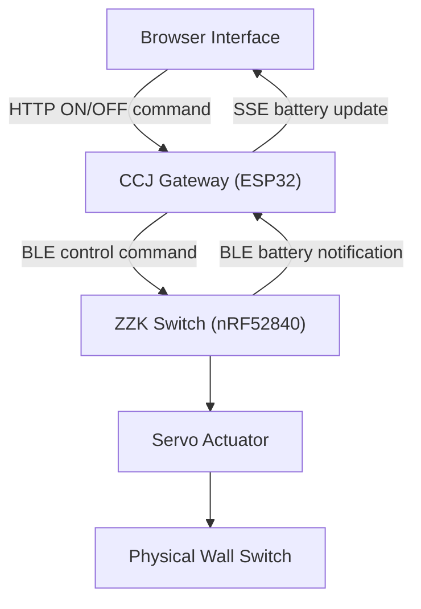

# CCJ Gateway

The CCJ Gateway is an ESP32-based Wi-Fi-to-BLE gateway that allows users to operate a physical dormitory light switch through a web interface and remotely monitor the battery level of the switch unit.

## System Overview

The CCJ Gateway and ZZK Switch form a web-controlled smart light switch system developed for use in a student dormitory. The system uses a servo motor to physically operate an existing wall switch without modifying the room's electrical wiring.

The CCJ Gateway connects to a Wi-Fi network and hosts the browser-based control interface. When the user selects an ON or OFF command, the gateway receives the HTTP request and writes a one-byte command to the ZZK Switch through Bluetooth Low Energy (BLE).

The ZZK Switch periodically measures its battery voltage and sends the estimated battery percentage to the gateway through BLE notifications. The gateway then pushes the latest value to the web interface using Server-Sent Events (SSE).

This repository contains the software for the CCJ Gateway. The switch-side software is available in the [ZZK Switch repository](https://github.com/coauther/ZZK-BLE-Switch-Assistant).

## Responsibilities of the CCJ Gateway

The CCJ Gateway is responsible for:

- Connecting to Wi-Fi and hosting the web control interface
- Receiving ON and OFF commands through an HTTP endpoint
- Scanning for nearby ZZK Switch devices
- Binding to a selected switch using its BLE MAC address
- Storing the selected MAC address in non-volatile memory
- Transmitting one-byte control commands through BLE
- Receiving battery-level notifications from the ZZK Switch
- Pushing battery updates to the webpage through SSE
- Automatically scanning for the switch again after disconnection
- Temporarily releasing the BLE connection for switch OTA updates, with automatic recovery

## System Architecture
The system uses the CCJ Gateway as a communication bridge between the browser-based user interface and the battery-powered ZZK Switch.



The system contains two main data flows:

1. **Light control:** The browser sends an HTTP request to the CCJ Gateway. The gateway converts the request into a one-byte BLE command and transmits it to the ZZK Switch, which then operates the servo motor.

2. **Battery monitoring:** The ZZK Switch measures its battery voltage through the ADC and periodically sends the estimated battery percentage through a BLE notification. The CCJ Gateway forwards the latest value to the browser using Server-Sent Events (SSE).

## Hardware and Software

| Category | Component or Technology |
|---|---|
| Development board | uPesy ESP32 Wroom DevKit |
| Programming language | C++ |
| Development framework | Arduino framework |
| Network connection | Wi-Fi |
| Web communication | HTTP and Server-Sent Events (SSE) |
| Device communication | Bluetooth Low Energy (BLE) |
| Web server | ESPAsyncWebServer |
| Data format | JSON and plain-text HTTP responses |
| Device identification | BLE service UUID and MAC address |
| Persistent storage | ESP32 Preferences |
| Companion device | Seeed Studio XIAO nRF52840 |

### Main Software Libraries

- `WiFi` for network connectivity
- `AsyncTCP` and `ESPAsyncWebServer` for the web server
- `BLEDevice` for BLE scanning and communication
- `Preferences` for storing the selected switch MAC address
- `ArduinoJson` for generating BLE scan results

## 蓝牙 OTA 维护模式

适配开关端的 `ZZK-SA2` / `ZZK-SA2-XXXX` 广播名称及现有服务 UUID。开关只有一个 BLE 从机连接，网关长期连接时，电脑或手机无法接入烧录。维护模式会临时释放连接并暂停自动重连，**保留已绑定 MAC，不删除配对信息，也不写入维护状态到 Flash**。

### 使用步骤

1. 首次更新网关：将 `include/config_example.h` 复制为 `include/config.h`，填入自己的 Wi-Fi 信息，执行 `pio run -t upload`。构建平台固定为 `platformio/espressif32 @ 6.10.0`（Arduino 2.0.17），与当前 BLE / ESPHome Web 库兼容。
2. 打开网关网页，已绑定设备可直接使用，无需重新绑定。点击 **临时释放连接（180 秒）**。
3. 等网页显示 **连接已释放，可开始烧录** 和倒计时，再用开关附近的电脑运行开关仓库的 `python ota_flash.py`，或用手机 Nordic DFU 工具升级。正在扫描或连接时会先完成并释放当前操作，然后才开始计时。
4. 升级结束可点击 **立即恢复连接**；否则 180 秒后自动恢复扫描并连接原绑定设备。时间不足时可点击 **延长至 180 秒**。

倒计时运行在网关上，关闭或刷新网页不会影响它。维护期间暂停灯控、网关扫描与重新绑定，丢弃尚未执行的灯控指令；已开始执行的指令无法撤回。网关重启后直接恢复正常连接模式。恢复后重新发现 GATT 服务和特征值，重新订阅电量，避免使用升级前的特征句柄。

这里只释放网关对开关的 BLE 占用；固件仍由附近电脑或手机传输，网关不代理固件上传。通过远程电脑烧录时，该电脑的蓝牙适配器仍需在开关通信范围内。`XIAO_DFU` 是烧录引导设备，不应重新绑定为日常开关。

开关的首次 Bootloader 准备、固件包生成及烧录方法见 [开关 OTA 指南](https://github.com/coauther/ZZK-BLE-Switch-Assistant/blob/main/docs/ota-guide.zh-CN.md)。本文的默认维护时间与 [开关维护模式说明](https://github.com/coauther/ZZK-BLE-Switch-Assistant/blob/main/docs/esphome-guide.zh-CN.md#3-防抢占维护模式) 一致。

### 远程控制接口

以下命令将 `GATEWAY_IP` 替换为网关地址；Windows PowerShell 可使用 `curl.exe`。

```sh
curl -X POST http://GATEWAY_IP/maintenance -d "action=release"
curl http://GATEWAY_IP/status
curl -X POST http://GATEWAY_IP/maintenance -d "action=resume"
```

| 接口 | 行为 |
|---|---|
| `POST /maintenance`，表单 `action=release` | 返回 `202`，进入释放流程；重复调用重新预留 180 秒 |
| `POST /maintenance`，表单 `action=resume` | 返回 `202`，请求提前恢复连接 |
| `GET /status` | 返回 `bound_mac`、`connected`、`battery`、`maintenance`、`maintenance_state`、`remaining_seconds`，禁止缓存 |
| `GET /control?action=0` 或 `1` | 维护期间返回 `409`，未连接返回 `503`，不排队补发 |
| `GET /scan` / `GET /bind?mac=...` | 维护期间或 BLE 操作忙时返回 `409`，稍后重试 |

`maintenance_state` 依次为 `releasing` → `active` → `resuming` → `normal`。只有 `active` 才表示连接已释放，可以开始烧录。恢复连接后的 `connected=true` 表示灯控特征已就绪。未绑定设备时，维护请求返回 `409`；缺失或无效动作返回 `400`。

接口沿用现有网关的局域网访问方式，没有新增身份验证。远程操作请使用已有的可信网络访问路径。

## Validation

Build with a local `include/config.h` (do not commit credentials):

```sh
pio run
```

Host tests need a C++11 compiler; the gateway test compiles the actual HTTP handlers and BLE loop against simulated hardware. These tests do not replace an ESP32/nRF52840 radio test.

```sh
g++ -std=c++11 -Wall -Wextra -Iinclude tests/ota_maintenance_test.cpp -o .pio/ota_test
g++ -std=c++11 -Wall -Wextra -Itests/stubs -Iinclude tests/gateway_test.cpp -o .pio/gateway_test
.pio/ota_test
.pio/gateway_test
```

Browser tests use Node.js and Playwright with mocked HTTP responses:

```sh
npm install --no-save --package-lock=false playwright
npx playwright install chromium
node tests/web_ui_test.cjs
```

Alternatively set `PLAYWRIGHT_CHANNEL=msedge` to use installed Edge. Set `CCJ_UI_SCREENSHOT` to an output image path to capture the mobile maintenance screen.

Before deploying, verify on hardware: release a connected switch and one currently reconnecting; discover it with the OTA tool; finish a real DFU; confirm manual/automatic reconnection and battery updates; verify the binding survives maintenance and gateway restart. A nearby BLE radio and physical switch are required for these checks.
