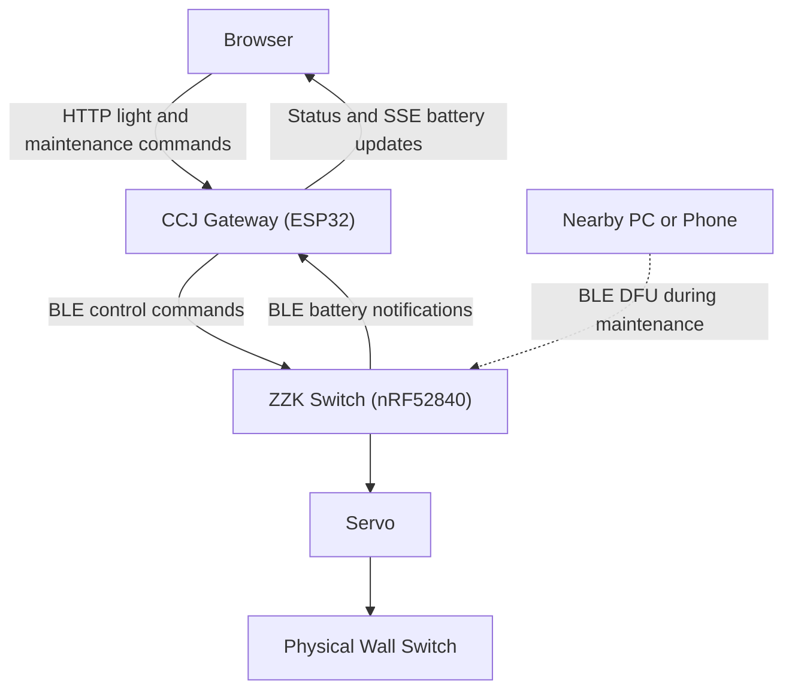

# CCJ Gateway

**English** | [中文](README.zh-CN.md)

[Quick Start](#quick-start) · [Hardware](#hardware-and-software) · [BLE Interface](#ble-interface) · [OTA Maintenance](#ota-maintenance) · [HTTP API](#http-api) · [Known Limitations](#known-limitations)

CCJ Gateway is an ESP32-based Wi-Fi-to-BLE gateway for the [ZZK Switch Assistant 2 (ZZK-SA2)](https://github.com/coauther/ZZK-BLE-Switch-Assistant). It provides browser-based light control, battery monitoring, device binding, and a temporary BLE release mode for wireless switch firmware updates.

---

## Overview

The gateway and the battery-powered ZZK switch work together to operate an existing wall switch without modifying the room's electrical wiring. The ESP32 hosts the web interface and sends commands over BLE; the nRF52840 switch drives the servo.

The gateway provides:

- Separate ON and OFF commands through the web interface.
- Scanning for nearby ZZK switches and binding to a selected MAC address.
- Persistent binding stored with ESP32 Preferences.
- Battery readings and live updates through Server-Sent Events (SSE).
- Automatic reconnection to the bound switch.
- A 180-second OTA maintenance window, with extension and manual recovery.

This repository contains the **gateway firmware**. Switch firmware, mechanical assembly, and switch OTA tools are maintained in the [ZZK switch repository](https://github.com/coauther/ZZK-BLE-Switch-Assistant).

---

## System Architecture



The browser sends a light command to the gateway, which writes a one-byte BLE value to the switch. Battery notifications travel in the opposite direction and are forwarded to the browser.

During OTA maintenance, the gateway releases its BLE connection so that a nearby computer or phone can connect to the switch and transfer firmware.

---

## Hardware and Software

| Category | Component / Configuration |
|---|---|
| Gateway board | uPesy ESP32 Wroom DevKit |
| Companion switch board | Seeed Studio XIAO nRF52840 |
| Language / Framework | C++ / Arduino |
| Build system | PlatformIO, environment `upesy_wroom` |
| ESP32 platform | `platformio/espressif32 @ 6.10.0`, Arduino 2.0.17 |
| Network connection | Wi-Fi |
| Switch connection | Bluetooth Low Energy (BLE) |
| Web communication | HTTP and Server-Sent Events (SSE) |
| Data formats | JSON and plain text |
| Device identification | Bound MAC address and switch service UUID |
| Persistent storage | ESP32 Preferences |

### Main Libraries

- `WiFi` for network connectivity.
- `AsyncTCP` and `ESPAsyncWebServer` for the web server.
- `BLEDevice` for BLE scanning and communication.
- `Preferences` for storing the bound MAC address.
- `ArduinoJson` for scan results and status responses.

The ESP32 platform version is pinned in [platformio.ini](platformio.ini) to keep the Arduino 2.x BLE API compatible with the existing ESPHome web libraries.

---

## Quick Start

### Requirements

- PlatformIO Core or PlatformIO IDE.
- An ESP32 gateway board and a USB cable for flashing.
- A ZZK-SA2 switch with its firmware already installed.
- Wi-Fi credentials for the gateway.

Run the following commands from the gateway repository root.

### Wi-Fi Configuration

Copy the example configuration:

```sh
cp include/config_example.h include/config.h
```

In Windows PowerShell:

```powershell
Copy-Item include/config_example.h include/config.h
```

Edit `include/config.h` with your Wi-Fi credentials:

```cpp
#define WIFI_SSID "YOUR_SSID"
#define WIFI_PASSWORD "YOUR_PASSWORD"
```

The file is excluded by `.gitignore`. Keep your local credentials out of version control.

### Build and Flash

Connect the ESP32 over USB, then run:

```sh
pio run
pio run -t upload
pio device monitor
```

The serial monitor uses **115200 baud**. After Wi-Fi connects, open the IP address printed in the serial monitor.

If Wi-Fi does not connect within 30 seconds, the gateway starts a temporary access point named `CCJ-Gateway-Setup`. Connect to that network and open the access-point IP printed in the serial monitor. This fallback provides access to the gateway page; it does not provide a Wi-Fi configuration form.

### Bind and Control a Switch

1. Open the device scanning panel in the web interface.
2. Scan for the switch, select its MAC address, and save the binding.
3. Wait for the connected status before sending an ON or OFF command.

The bound MAC survives gateway restarts. If another phone, computer, or gateway already occupies the switch's BLE connection, disconnect that client before scanning.

The controls send actions; they do not report the physical ON/OFF state of the light. The web interface currently uses Chinese; button names in the English instructions below describe their functions in English.

---

## BLE Interface

The gateway supports `ZZK-SA2` and `ZZK-SA2-XXXX` device names. Active scanning reads the name from the scan response. Automatic reconnection matches the **saved MAC address and switch service UUID**, rather than relying only on the name.

| Service / Characteristic | UUID | Gateway Operation |
|---|---|---|
| Switch service | `2d220000-516b-47bd-a33b-2c93889ac9b7` | Discover the switch service |
| Switch control | `2d220001-516b-47bd-a33b-2c93889ac9b7` | Write `0x01` for ON or `0x00` for OFF |
| Battery level | `2d220002-516b-47bd-a33b-2c93889ac9b7` | Read and subscribe to notifications; percentage from 0 to 100 |

Here, **binding** means saving a target MAC address in the gateway. The custom switch characteristics do not require Bluetooth security pairing.

---

## OTA Maintenance

### Why Release the Connection?

ZZK-SA2 supports one central connection at a time and stops advertising while connected. A persistent gateway connection prevents the OTA tool from discovering and connecting to the switch.

Maintenance mode temporarily disconnects the gateway and suspends reconnection for **180 seconds**, while preserving the saved binding.

### Update the Switch

1. Prepare the switch bootloader and firmware package using the [switch OTA guide](https://github.com/coauther/ZZK-BLE-Switch-Assistant/blob/main/docs/ota-guide.md).
2. Open the gateway web interface and select **Release connection (180 seconds)**.
3. Wait until the page reports that the connection is released and the countdown begins. An in-progress scan or connection is allowed to finish and release before the timer starts.
4. From a computer within BLE range, run the following command in the **switch repository**, or use a mobile Nordic DFU tool:

   ```sh
   python ota_flash.py
   ```

5. After flashing, select **Resume connection now**, or wait for automatic recovery. Select **Extend to 180 seconds** if more time is needed.

### Maintenance Behavior

| Situation | Behavior |
|---|---|
| Refreshing or closing the page | The timer continues on the gateway |
| Repeating the release request | Reserves a new 180-second window after release is confirmed |
| Light control, scanning, or rebinding during maintenance | Requests are rejected |
| Pending light commands | Discarded; not replayed after reconnection |
| A command already executing | Cannot be recalled |
| Manual recovery or timer expiry | Reconnection to the saved device resumes |
| Gateway restart | Normal connection mode resumes; binding remains saved |
| Reconnection after updating | Services and characteristics are rediscovered, and battery notifications are subscribed again |

The gateway only releases the BLE connection. Firmware is transferred by the nearby computer or phone. For flashing from a remotely controlled computer, that computer's Bluetooth adapter must still be within range of the switch.

`XIAO_DFU` is the switch's bootloader identity; do not bind it as the normal switch. The default window follows the 180-second maintenance workflow described in the [switch ESPHome guide](https://github.com/coauther/ZZK-BLE-Switch-Assistant/blob/main/docs/esphome-guide.md).

---

## HTTP API

### Endpoints

| Method / Endpoint | Purpose |
|---|---|
| `GET /` | Open the control page |
| `GET /control?action=0` or `1` | Queue an OFF or ON command when connected |
| `GET /scan` | Return nearby matching devices as a JSON array |
| `GET /bind?mac=...` | Save the target MAC and start connecting |
| `GET /battery` | Return battery percentage or `Waiting...` |
| `GET /events` | SSE stream with named `battery` events |
| `GET /status` | Return connection and maintenance status, with caching disabled |
| `POST /maintenance` | Accept a URL-encoded form field `action=release` or `action=resume` |

### Maintenance Requests

Replace `GATEWAY_IP` with the gateway address. In Windows PowerShell, use `curl.exe` if `curl` resolves to a PowerShell alias.

```sh
curl -X POST http://GATEWAY_IP/maintenance -d "action=release"
curl http://GATEWAY_IP/status
curl -X POST http://GATEWAY_IP/maintenance -d "action=resume"
```

Maintenance requests return `202` when accepted. This acknowledges the request, not completion of the BLE transition.

| Status Field | Meaning |
|---|---|
| `bound_mac` | Saved switch MAC; empty if no device is bound |
| `connected` | Whether the control characteristic is ready |
| `battery` | Battery percentage, or `-1` when unavailable |
| `maintenance` | Whether maintenance is blocking normal BLE operations |
| `maintenance_state` | `normal`, `releasing`, `active`, or `resuming` |
| `remaining_seconds` | Countdown while `active`; otherwise `0` |

The usual state sequence is `releasing` → `active` → `resuming` → `normal`. Start flashing only when the state is **`active`**. After recovery, wait for **`connected=true`** before controlling the light.

### Error Responses

- Maintenance: `400` for a missing or invalid action; `409` if no switch is bound.
- Light control: `400` for a missing or invalid action; `409` during maintenance; `503` when disconnected.
- Scanning and binding: `409` during maintenance or while another BLE operation is busy.
- Binding: `400` for a missing or invalid MAC; `500` if the binding cannot be saved.

Rejected light commands are not queued for later execution.

---

## Validation

### Firmware Build

Create your local `include/config.h`, then run:

```sh
pio run
```

### Host Logic Tests

After building, use a C++11 compiler to run the timer tests and the gateway's actual HTTP handlers and BLE loop against simulated hardware:

```sh
g++ -std=c++11 -Wall -Wextra -Iinclude tests/ota_maintenance_test.cpp -o .pio/ota_test
g++ -std=c++11 -Wall -Wextra -pthread -Itests/stubs -Iinclude tests/gateway_test.cpp -o .pio/gateway_test
.pio/ota_test
.pio/gateway_test
```

On Windows, use a compatible compiler such as MinGW and the generated `.exe` filenames.

### Browser Tests

The browser tests use Node.js, Playwright, and mocked HTTP responses:

```sh
npm install --no-save --package-lock=false playwright
npx playwright install chromium
node tests/web_ui_test.cjs
```

Set `PLAYWRIGHT_CHANNEL=msedge` to use installed Edge instead. Set `CCJ_UI_SCREENSHOT` to an image path to capture the mobile maintenance screen.

### Hardware Validation

Automated tests do not replace an ESP32/nRF52840 radio test. Before deployment, verify:

- Release works both while connected and while reconnecting.
- The OTA tool discovers the switch and completes a real DFU.
- Manual and automatic recovery restore control and battery updates.
- The saved binding survives maintenance and a gateway restart.

---

## Known Limitations

- **No physical state feedback:** successful command delivery does not confirm that the light changed state.
- **BLE range still applies:** the gateway and OTA client must be close enough to communicate with the switch.
- **No firmware relay:** the gateway does not upload switch firmware over Wi-Fi or provide gateway firmware OTA.
- **Network access:** the HTTP interface has no authentication. Use it through a trusted network access path.
- **Hardware verification required:** the OTA maintenance implementation has passed build and automated checks; real-device DFU validation remains necessary.

---

## Related Projects

- [ZZK Switch Assistant 2](https://github.com/coauther/ZZK-BLE-Switch-Assistant)
- [Switch OTA Firmware Update Guide](https://github.com/coauther/ZZK-BLE-Switch-Assistant/blob/main/docs/ota-guide.md)
- [Switch ESPHome Integration Guide](https://github.com/coauther/ZZK-BLE-Switch-Assistant/blob/main/docs/esphome-guide.md)

---

## License

This project is licensed under the MIT License. See [LICENSE](LICENSE) for details.

---

**English** | [中文](README.zh-CN.md)